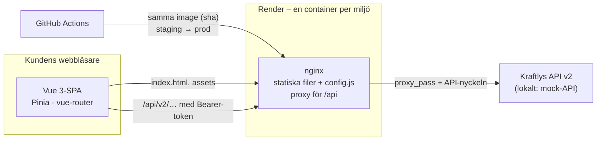
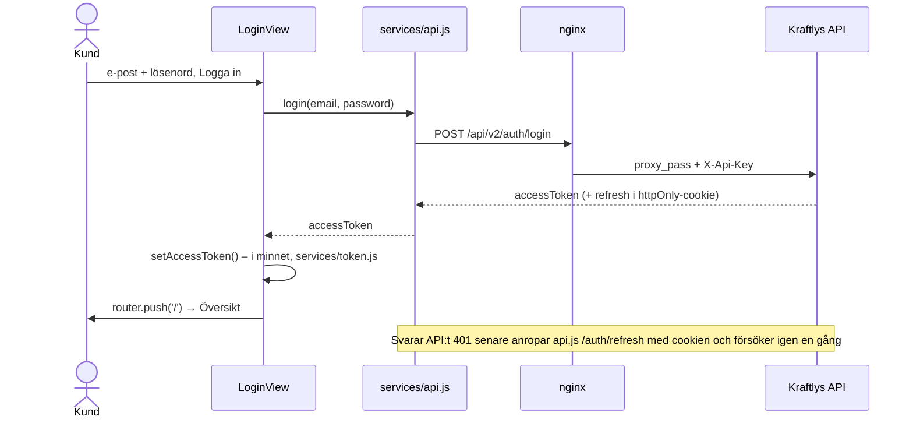

# Arkitektur

## Översikt

Kraftly - Mina sidor är en Vue 3-SPA: `vite build` ger statiska filer som nginx serverar från en container, och all HTML byggs i webbläsaren utan server-rendering (se [docs/decisions/rendering.md](decisions/rendering.md)). nginx proxar `/api/` vidare till Kraftlys API och lägger på API-nyckeln (`X-Api-Key`), så nyckeln aldrig hamnar i JavaScript-filerna. Eftersom containern bara serverar filer och proxar, finns inget tillstånd att hålla reda på: skala genom att starta fler likadana containrar, och driftsätt genom att byta image.

## Lagren i frontend

| Lager         | Ansvar                                                                                       | Regel                                                                                                                                            |
| ------------- | -------------------------------------------------------------------------------------------- | ------------------------------------------------------------------------------------------------------------------------------------------------ |
| `views/`      | Sidorna routern känner till                                                                  | Hämtar data via stores – undantag: `LoginView`, `InvoicesView` och `MoveFormView` anropar `services/api` direkt, eftersom datan bara används där |
| `components/` | Återanvändbara delar (`KButton`, `KField`, `StatusChip`, `ConsumptionChart`, `NorwayNotice`) | Vet ingenting om API:t                                                                                                                           |
| `stores/`     | Tillstånd som delas mellan vyer (Pinia: `user`, `consumption`)                               | Anropar `services/`                                                                                                                              |
| `services/`   | HTTP mot API:t (`api.js`), token i minnet (`token.js`)                                       | Ingen Vue-kod Undantag: `token.js` håller token i en `ref`                                                                                       |
| `utils/`      | Rena funktioner (datum, format, validering, fakturastatus, feature flags)                    | Inga sidoeffekter, därför lätta att testa                                                                                                        |
| `router/`     | Rutterna och guarden för inloggning                                                          | Guarden skickar utloggade till `/login` bara för upplevelsen, det riktiga skyddet är att API:t svarar 401 utan giltig token                      |

Beroendena pekar nedåt: vy → store → service. Aldrig tvärtom.

## Ett flöde: inloggningen

## Miljöer

| Miljö        | Adress                                        | Uppdateras                                 | Norge-flaggan | API                                 |
| ------------ | --------------------------------------------- | ------------------------------------------ | ------------- | ----------------------------------- |
| Dev (lokalt) | http://localhost:8080 (Docker) · :5173 (Vite) | när du vill                                | på            | mock-API (`npm run api`, port 4000) |
| Staging      | https://kraftly-tesla-staging.onrender.com    | varje merge till `main`                    | på            | https://kraftly-api.sprinto.cloud   |
| Prod         | https://kraftly-tesla.onrender.com            | samma image som staging, efter godkännande | av            | https://kraftly-api.sprinto.cloud   |

Samma image går genom miljöerna, konfigurationen skiljer dem åt, inte koden.

## Beslut

De tre viktigaste – alla beslut finns i [`docs/decisions/`](decisions/):

- [Hosting](decisions/hosting.md) - en container på Render, imagen byggs en gång och taggas med commitens sha i GHCR
- [Tokenlagring](decisions/tokenlagring.md) - access token i minnet, refresh token i httpOnly-cookie som API:t sätter
- [Feature flags](decisions/feature-flags.md) - Norge bakom en flagga i `config.js`, som containern skriver vid start från miljövariabeln `FEATURE_NORWAY` i Render
