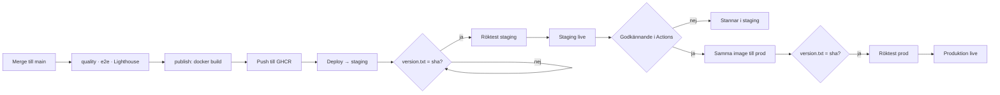
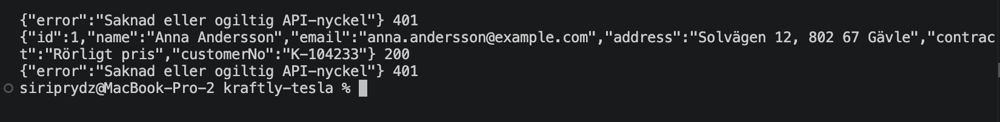

# Deploy – Kraftly Mina sidor

## Flödet

Efter merge till main bygger CI en Docker-image, pushar till GHCR och deployar till staging (deploy hook, `version.txt`, röktest). Samma image går sedan till produktion, men bara efter godkännande under Actions → Review deployments. Ingen ny build. Saknas `RENDER_DEPLOY_HOOK` i miljön production hoppar jobbet över.

## Miljöer

| Miljö          | URL                                          | Image                                   | API                                 | Uppdateras                                     |
| -------------- | -------------------------------------------- | --------------------------------------- | ----------------------------------- | ---------------------------------------------- |
| Lokal (dev)    | `http://localhost:5173`                      | —                                       | mock-API på `:4000` via Vite-proxy  | manuellt (`npm run dev` + `npm run api`)       |
| Lokal (Docker) | `http://localhost:8080`                      | byggs lokalt                            | `http://api:4000` internt i compose | `docker compose up --build`                    |
| Staging        | `https://kraftly-tesla-staging.onrender.com` | `ghcr.io/siriprydz/kraftly-tesla:main`  | `https://kraftly-api.sprinto.cloud` | automatiskt vid merge till `main`              |
| Prod           | `https://kraftly-tesla.onrender.com`         | `ghcr.io/siriprydz/kraftly-tesla:<sha>` | `https://kraftly-api.sprinto.cloud` | `APP_ENV=production`; deploy efter godkännande |

## Konfiguration – var bor vad?

| Variabel             | Hemlig?   | Lokalt                                                        | Staging                                                    | Används av                                              |
| -------------------- | --------- | ------------------------------------------------------------- | ---------------------------------------------------------- | ------------------------------------------------------- |
| `API_KEY`            | Ja        | `.env`                                                        | Render → Environment                                       | Vite-proxy / nginx (skickas som `X-Api-Key` till API:t) |
| `API_URL`            | Nej       | `.env` (tom = mock; lokal adress i Vite, `api:4000` i Docker) | Render → Environment (`https://kraftly-api.sprinto.cloud`) | Vite-proxy / nginx (proxar `/api/`)                     |
| `PORT`               | Nej       | `80` i compose                                                | Render sätter själv                                        | nginx (`listen`)                                        |
| `RENDER_DEPLOY_HOOK` | Ja        | —                                                             | GitHub → Environment `staging` → Secrets                   | `deploy-staging`-jobbet (triggar Render)                |
| `STAGING_URL`        | Nej       | —                                                             | GitHub → Environment `staging` → Variables                 | deploy + verifiering (`version.txt`, röktest)           |
| `GITHUB_TOKEN`       | Ja (auto) | —                                                             | GitHub Actions (inbyggd)                                   | push till GHCR                                          |

## API-nyckeln

Behöver du en riktig `API_KEY`, åtkomst till Render eller GitHub Secrets: vänd dig till tech lead (vem det är den här veckan står i README under Working Agreement). Nycklar skickas inte i chatten och committas inte.

Den gamla API-nyckeln roterades, dvs den dödades av backend-teamet (Jonathan). Den fungerar inte längre, därför blir utskriften 401. Den nya nyckeln ligger i Render som en environment secret och skrivs inte ut någonstans.

Vi valde att inte skriva om historiken. Nyckeln är roterad och därför värdelös nu. Att skriva om historik i ett delat repo med flera aktiva branches och en körande pipeline är en oproportionerlig risk (force-push, trasiga PR:ar, alla måste klona om etc) för en nyckel som redan är värdelös. Eftersom nyckeln inte innehåller någon annan känslig information så valde vi att inte riskera de oönskade konsekvenserna denna gång.

## Rollback

Varje image i GHCR är taggad med sin commit-sha. En rollback är en deploy av en äldre tagg, ingen ny build. Samma workflow backar staging eller production. `main` ändras inte, bara det som kör i Render.

Verifiera med `version.txt` i browsern: [staging](https://kraftly-tesla-staging.onrender.com/version.txt) · [prod](https://kraftly-tesla.onrender.com/version.txt).

### GitHub Actions (`rollback.yml`)

Workflowen `.github/workflows/rollback.yml` körs för hand: **Actions → Rollback → Run workflow**. Ingen ny build, bara deploy av `ghcr.io/siriprydz/kraftly-tesla:<sha>`.

1. **GitHub** → Commits → kopiera hela sha:n för commiten du vill tillbaka till
2. Packages → kontrollera att sha:n finns som tagg (bara commits som mergats till `main` och pushats till GHCR finns där; PR:ar och lokala commits saknar tagg)
3. Actions → Rollback → Run workflow → välj **staging** eller **production** → klistra in sha:n → Run workflow
4. Production kräver godkännande, precis som en vanlig prod-deploy (Review deployments)
5. Vänta tills jobbet är grönt
6. Verifiera: ladda om miljön och öppna `version.txt` – den ska visa den gamla sha:n

**Tillbaka till nuläget:** kör rollback med senaste sha:n, eller CI med Run workflow på `main`.

### Render Dashboard

1. **Render** web service `kraftly-tesla-staging` eller `kraftly-tesla` (prod) → Events
2. Hitta en tidigare lyckad deploy → Rollback to this deploy
3. Verifiera med den miljöns `version.txt` – sha:n ska matcha den deploy du rullade tillbaka till

Bara den som har tillgång till Render-kontot kan göra dashboard-vägen. Resten av teamet använder Actions.

## Tider (uppmätta)

| Steg                                 | Tid                       | Hur                                                                                      |
| ------------------------------------ | ------------------------- | ---------------------------------------------------------------------------------------- |
| Merge → publish klar                 | 1 min 28 s                | `e2e` (50s) + `Image → GHCR` (38s) testjobben körs parallellt, publish väntar på längsta |
| Hook → rätt sha svarar               | ~7 s                      | Hela `Deploy → staging`-jobbet (hook + väntan + röktest)                                 |
| Totalt merge → staging live          | 1 min 35 s                | 50s + 38s + 7s                                                                           |
| Kallstart (efter 15 min inaktivitet) | ej uppmätt, men ca 30-90s | Mät i browsern: Render + test-API sover                                                  |

## Kända begränsningar

Kallstart tar tid eftersom det är ett gratiskonto på Render. Siri äger Render-kontot, så bara hon kommer åt inställningarna där, resten av teamet ber tech lead.

Produktion är `https://kraftly-tesla.onrender.com` och får samma image som staging, efter godkännande i Actions. Saknas `RENDER_DEPLOY_HOOK` i miljön production hoppar jobbet över och staging är då den enda live-miljön.
